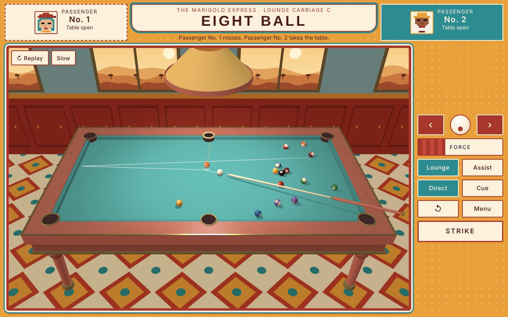
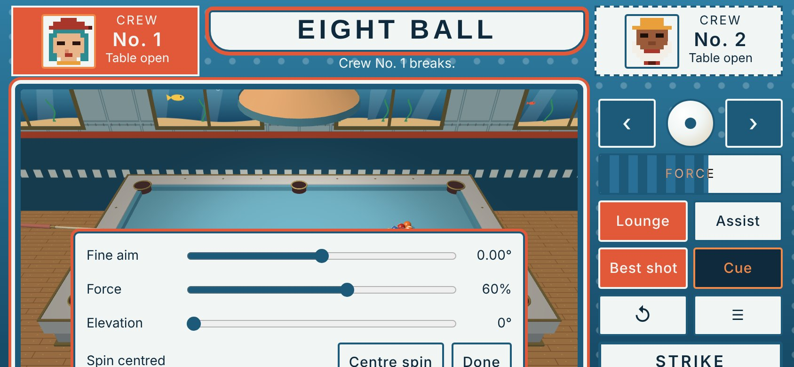
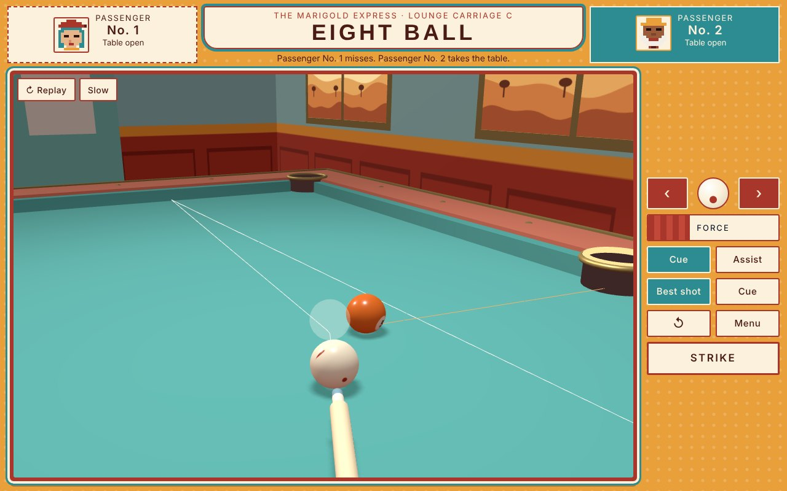
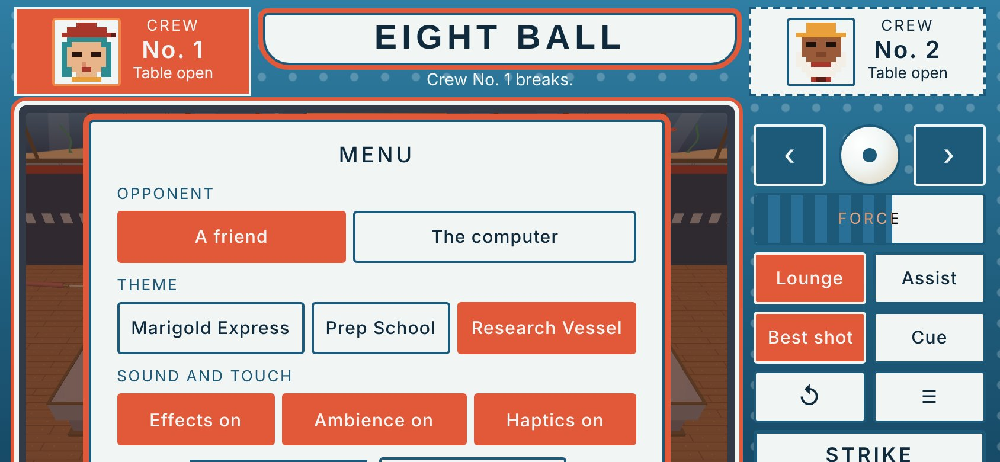
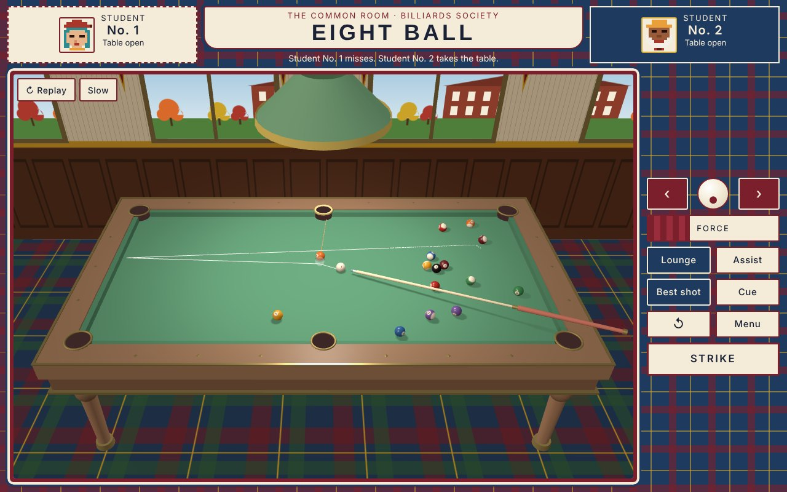
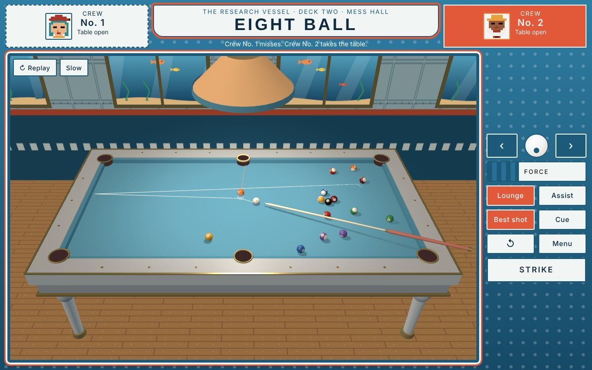
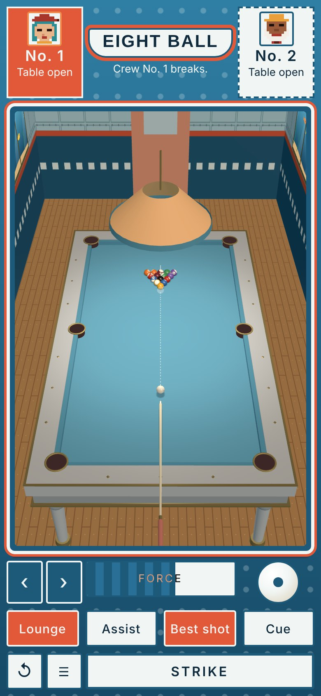

# Eight Ball: The Marigold Express

A 3D eight-ball pool game that runs in your browser, with real physics, a computer opponent, shot assist, replays, stats, and three hand-made themes. The whole game is one HTML file.

**Play it here: https://ddmsel.github.io/marigold-pool/**

## Features

* Real physics with rolling friction, cushion rebounds, follow, draw, side spin and swerve shots
* Full eight-ball rules, including fouls, ball in hand, the open table and the eight ball
* Play a friend on the same device, or the computer at three skill levels
* **Assist** draws where the cue ball and the first two balls will go, worked out with the same physics as the real shot
* **Best shot** finds and lines up a good shot for you, preferring direct pots, then one or two cushion banks
* **Replay** any shot, at full speed or in slow motion
* Three camera views: Lounge, Above, and Cue (behind the cue ball)
* Three themes with their own rooms, colours and ambient sound
* Stats for the current game and your all-time record on the device
* Works on phones, tablets and computers, upright or sideways

## How to play

### Aim and shoot

| To do this | Do this |
| --- | --- |
| Point the cue roughly | Tap the felt where you want to aim |
| Fine-tune the aim | Drag around the cue ball. The slower you drag, the finer it turns |
| Nudge the aim | Tap ‹ or › (0.05° per tap). Hold to keep turning, slowly at first |
| Set the force | Slide the Force bar |
| Add spin | Tap the small white ball. High for follow, low for draw, left or right for side spin |
| Shoot | Press **Strike** |
| Place the cue ball after a foul | Drag it anywhere on the table, then press **Set ball** |

### The rules

* The first player breaks. The table stays open until someone pockets a ball after the break, which gives them that group (solids or stripes).
* Keep shooting while you pocket your own balls. Miss, and it is the other player's turn.
* It is a foul if the cue ball drops, if it hits nothing, or if it hits the wrong ball first. After a foul, the other player gets ball in hand.
* Once your group is cleared, pocket the eight to win. Sinking the eight early, or with a foul, loses the game.

### Helpers

* **Assist** shows the paths of the cue ball and the first two balls it meets. A gold ring marks a pocket your ball will drop into; a red ring warns of a scratch or the wrong ball.
* **Best shot** tests a few hundred shots and lines up the best one. The button briefly says what it chose: Direct, 1 bank, 2 banks, Combo or Safety. You can still adjust the shot before striking.
* **Replay** appears at the top left of the table after each shot. **Slow** plays it at a third of the speed.
* **↺** puts aim, force, spin, elevation and camera view back to their starting values.

### Finer cue controls

Press **Cue** to open the drawer.

* **Fine aim** turns the cue by hundredths of a degree and shows the exact angle.
* **Force** takes an exact percentage.
* **Elevation** raises the butt of the cue up to 60°. Combine it with side spin to curve the cue ball around a ball in the way.
* **Centre spin** clears any spin.

### Camera views

Press the view button to switch between **Lounge** (angled), **Above** (straight down) and **Cue** (behind the cue ball). In the Cue view, drag sideways to aim.

### Playing the computer

Open **Menu** (☰), choose **The computer**, and pick Easy, Medium or Hard. You play first. Easy misses often, Medium is steady, and Hard misses much less.

### Keyboard shortcuts

| Key | Action |
| --- | --- |
| ← → | Aim (hold Shift for finer steps) |
| ↑ ↓ | Force |
| Space | Strike |
| V | Change camera view |
| A | Assist on or off |
| B | Best shot |
| C | Cue controls |
| R | Reset controls |

## Themes

Choose a theme in the Menu. Each one changes the room, the table, the colours, the player names and the background sound.

| Marigold Express | Prep School | Research Vessel |
| --- | --- | --- |
|  |  |  |
| The lounge carriage of an overnight train, with desert hills rolling past the windows | A wood-panelled common room with tartan carpet and an autumn campus outside | A ship's mess hall with a teak deck and fish drifting past the windows |

## Sound, haptics and saved settings

* In **Menu → Sound and touch**, turn the sound effects, the theme's ambient sound and haptic taps on or off. Sound starts after your first tap, since browsers block audio until then.
* Haptics work where the browser allows it. On iPhone, Safari should give a tap on button presses and strikes.
* Your theme, opponent, sound settings and stats are saved in your browser on that device. **Menu → Stats** shows this game's numbers and your all-time record, with a button to reset them.

## On your phone

The game adapts to the screen. Held upright, the controls sit under the table; held sideways, they move to a side panel. To make it feel like an app, open the link in Safari and choose **Share → Add to Home Screen**.

## Run it yourself

Download `index.html` and open it in a browser, or host it anywhere that serves static files. It loads [three.js](https://threejs.org/) r128 from cdnjs and the Jost font from Google Fonts, so it needs an internet connection the first time.

## Notes

The three themes are original designs inspired by the films of Wes Anderson. They are not affiliated with or endorsed by anyone connected to those films.
